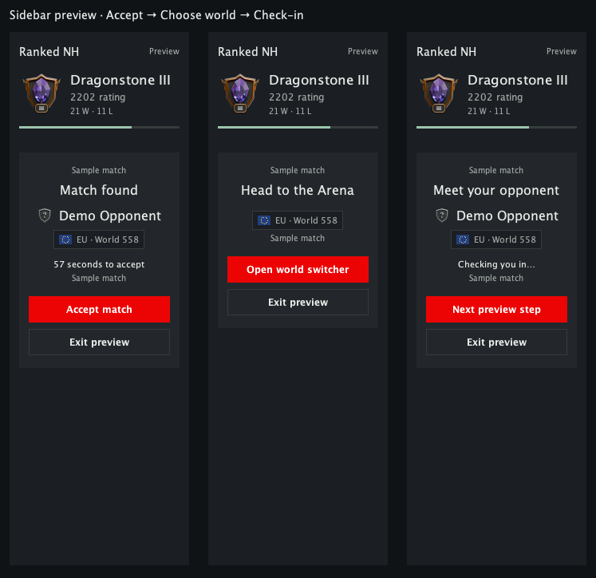

# Ranked NH

Find an NH opponent in Emir's Arena, play a best-of-three match and track your results in RuneLite.

The queue uses the Arena's default Max/Med items and quantity limits at 126 combat. Any item can be left out. Choose EU or US before searching. After 30 seconds, the queue can match you with someone from the other region.

**Ranked NH is an invite-only beta. It is not yet available to install through Plugin Hub. The Beta season awards ratings, which reset before public Season 1.**



## Joining the beta

Ask for an invitation in the [Ranked NH Discord](https://discord.gg/3fsrUg6VR). Each NH access key belongs to one RuneScape character. An NH key is separate from your game login. Keep it private.

Once the plugin is listed, install **Ranked NH** from RuneLite's Plugin Hub and open its sidebar. Paste your key, read the match-data notice, tick **Share match observations**, then click **Connect**. Log into the character named by your invitation.

The server address is already set to `https://ranked-nh.vercel.app`. Normal Plugin Hub use will not need the separate beta launcher or a game-login export. Before approval, invited testers should use the beta build supplied by the organiser.

## Playing a match

1. Choose EU or US. On your first visit, use **Open world switcher**, select the suggested Arena world and open **Supplies → Max/Med kit**. Fix any listed differences; **Find a match** unlocks once the check passes. The check is remembered for that character. **Cancel search** leaves the queue.
2. Accept the matchup in the sidebar. You can enable a sound and RuneLite notification for new matches.
3. Once both players accept, click **Open world switcher**, then select the assigned Arena world yourself. The plugin marks your opponent when they are nearby.
4. Challenge that player through the Arena, then select **Max/Med**. **Allowed items only** filters the item catalogue. Green counts show optional additions; red outlines mark forbidden items, excess quantities or incorrect settings. Any default item can be left out, and players can bring different subsets. Worn and carried copies count together toward the default limits. Ancient Magicks and all runes enabled are required. Follow **Opponent's kit**, then **Confirm** when both kits pass.
5. Play until one player has won two fights. Wait for both round reports before starting the next fight.

The plugin does not challenge players, change your loadout, click confirmation buttons or perform combat actions. **Copy Load-out** copies the opponent's current kit, so it is only useful when that kit is correct. Ranked NH does not provide a reset-to-default button.

## Results and ranks

Match history lives in the sidebar. After a completed match, a report appears in the middle of the game view. Close it with its close button or Escape. You can reopen it with **Show match report**.

Five completed rated series determine your first beta rank. Divisions run from **III to II to I**, with I highest within each gem. Rank changes use the service's recorded match results. Everyone starts Unranked with a hidden 1500 rating. Fixed thresholds put 1500 at Sapphire II after placements; joining players do not move the thresholds. Beta ratings reset before public Season 1.

**Preview ranks** lets you try a promotion or first-rank reveal between matches. Previews use sample data and never change your results. Sound, volume and reduced motion are available in the plugin settings.

## If something goes wrong

- **The queue is quiet:** both players need to be connected and searching. Cross-region matching opens after 30 seconds.
- **The queue button is unavailable:** check that you are on the invited character and have completed the supplies-crate kit check. Any queue cooldown is shown with its reason and end time.
- **Kit issue:** hover a red outline to see what to remove or change. Missing items are allowed. Substitutions outside the default list and quantities above its limits are not. Both players are checked independently.
- **A match is under review:** return to the lobby and contact the organiser. During an unrated test, **End test match** lets you leave the series without changing ratings.
- **The service disconnects:** reconnect with the same NH key. Keys expire after 30 days; ask the organiser for a replacement when needed.

Report plugin bugs through [GitHub issues](https://github.com/ImBenHayward/ranked-nh/issues). Include what you clicked, what happened and any visible error. Do not post access keys, game-login files or unredacted logs.

## Data and privacy

Connecting sends your NH access key to the configured service. After you opt in, it receives your queue and match actions, both matched players' Arena kits, and observations used to compare round results. Other enrolled players can see your NH rank. The public leaderboard is disabled for this beta.

Read [the data policy](PRIVACY.md) for the fields, retention and local storage details. The service is operated separately from RuneLite. RuneLite does not verify match results or operate the ladder.

## Building from source

Use Java 11 or newer:

```sh
./gradlew test jar
```

The tests cover queue actions during polling, region selection across refreshes, loadout comparison, report handling and rank assets. They use local fixtures and do not require an invitation or a live game account.

To launch a development client:

```sh
./gradlew run
```

For a Jagex account, follow [RuneLite's development-login instructions](https://github.com/runelite/runelite/wiki/Using-Jagex-Accounts). That handoff is for development, not normal Plugin Hub installation.

The plugin uses `build=standard` for Plugin Hub. [Review notes](REVIEW.md) describe the network calls, restricted APIs and bundled animation size. The entire repository, including the rank artwork and original reveal audio, uses the [BSD 2-Clause licence](LICENSE). See [asset notices](ASSET-LICENSE.md) for origins and attribution.
